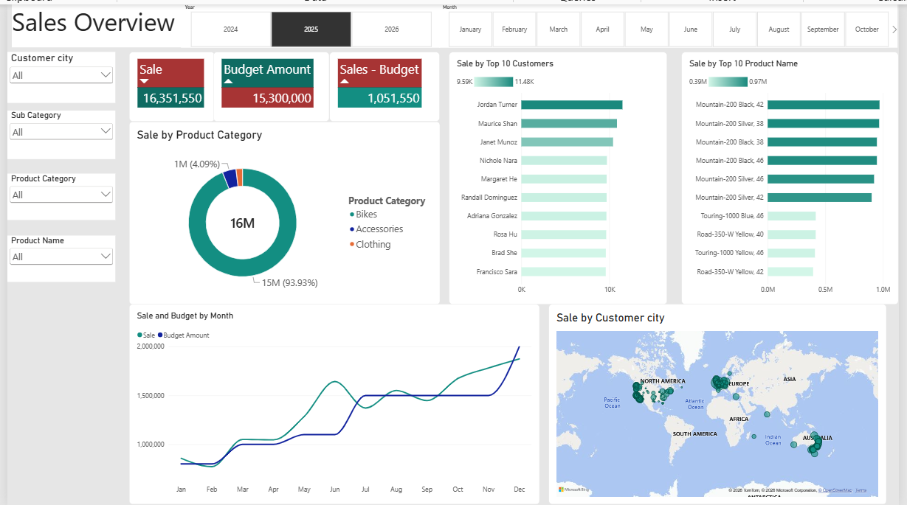
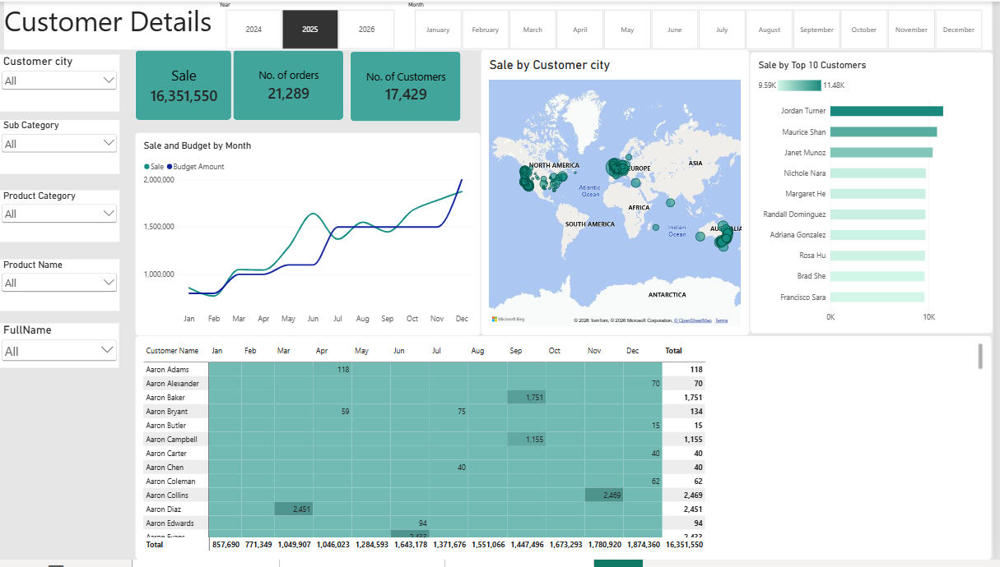
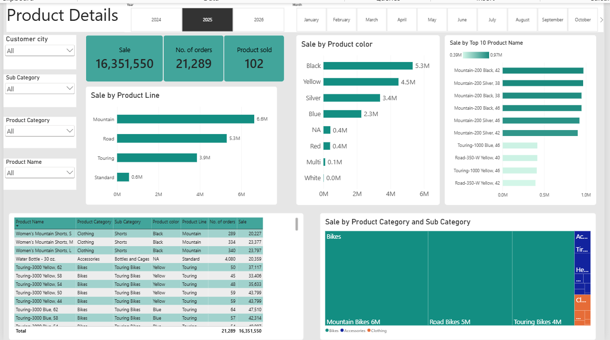

# Sales Performance Analysis | SQL Server · Excel · Power BI

**Business request:** The Sales Manager wanted to replace static sales reports with visual dashboards showing what was sold, to which customers and how sales changed over time, with filters for sales reps and a comparison against the budget.

**Data:** Microsoft AdventureWorksDW sample database (SQL Server) and a sales budget in Excel. Dates were shifted to 2024–2026 so the analysis covers recent years.

## What I did
- **SQL Server:** cleaned and prepared calendar, customer, product and internet sales tables (joins, CASE, ISNULL), keeping the last 2 years
- **Excel:** aligned the budget file's dates with the sales period
- **Power BI:** star-schema data model, DAX measures (Sales, Budget, Sales vs Budget, Orders, Customers) and a 3-page dashboard (Sales Overview, Customer Details, Product Details)

## Key insights (2025)
- Sales finished **6.9% above budget** (16.4M vs 15.3M), beating budget in 8 of 12 months
- Sales grew from **5.8M (2024) to 16.4M (2025)**, driven by 3× more bike orders and the launch of accessories and clothing
- **Bikes made up 94% of revenue**, with Mountain bikes the top product line (41%). **London** was the top city

## Dashboard

*Guided project based on Ali Ahmad's Power BI sales tutorial. Date adjustment script by David Alzamendi (techtalkcorner.com).*
